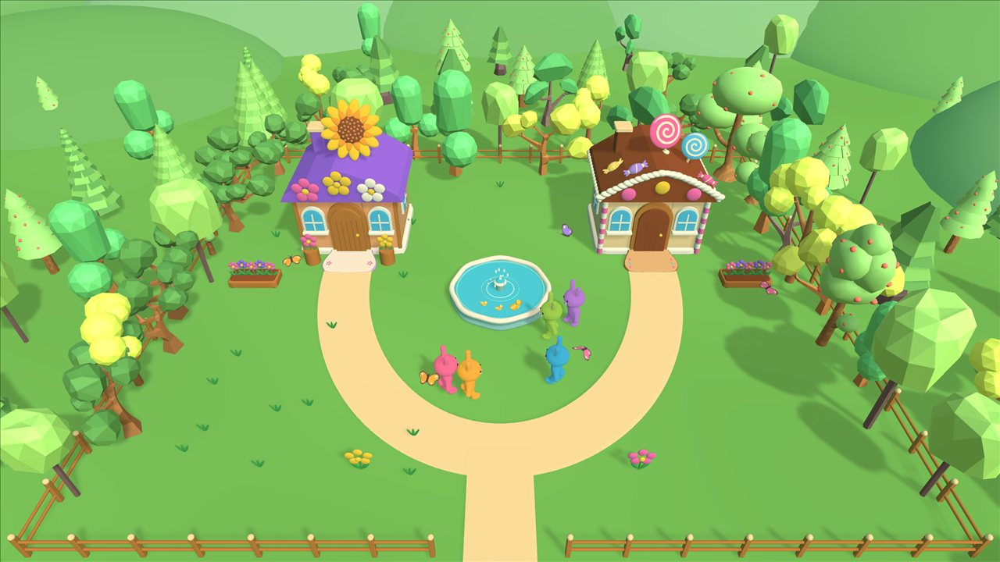

# 십분의 평화 (Ten Minutes of Peace)

아이가 색칠한 동물이 그림 속 색깔 그대로 3D 놀이 공간에 나타나 손을 흔들고 산책합니다. Windows와 Android에서 즐기는 가족용 색칠 게임으로, 동물 10종과 공원·숲·놀이터·사막·시계탑 광장·놀이공원을 만날 수 있습니다.

## 플레이 방법

1. 시작 화면에서 **놀이 공간 열기**를 누르고 장소를 고릅니다.
2. 한 기기에서 놀 때는 **동물 색칠하기**를 누릅니다. 다른 기기로 함께 놀 때는 두 기기를 같은 Wi-Fi에 연결하고, 두 번째 기기에서 **함께 놀기 → 자동 찾기**를 누릅니다.
3. 동물의 앞면과 뒷면을 색칠하고 **보내기**를 누릅니다. 놀이 공간에 나타난 동물을 터치하거나 클릭하면 카메라가 따라갑니다.

## Unity에서 실행하기

Unity Hub에서 **6000.6.8f1**로 프로젝트를 엽니다. **Peace Park → Open Living Park**로 메인 장면을 연 뒤 **Play**를 누릅니다.

숲과 사막을 포함하려면 Package Manager의 **My Assets**에서 각각 **Ultimate Nature – Starter**와 **Pandazole - Nature Environment Low poly Pack**을 가져옵니다. 숲속 빵집 모델은 **Lowpoly Baker’s House**를 사용합니다.

## 빌드

| 플랫폼 | Unity의 Peace Park 메뉴 | 출력 파일 |
| --- | --- | --- |
| Windows | Build Living Park Windows | `Builds/Windows/TenMinutesOfPeace.exe` |
| Android | Build Living Park Android APK | `Builds/Android/TenMinutesOfPeace.apk` |

Windows 빌드를 공유할 때는 `Builds/Windows` 폴더 전체를 복사합니다. Android 빌드에는 Unity Hub의 **Android Build Support**, **Android SDK & NDK Tools**, **OpenJDK** 모듈이 필요합니다.

### Android 기기로 다운로드하기

APK를 빌드한 뒤 프로젝트 폴더에서 `node apk-server.js`를 실행합니다. PC에서는 [다운로드 페이지](http://localhost:10282/)를 열고, 같은 Wi-Fi의 Android 기기에서는 브라우저에 `http://<PC의 IPv4 주소>:10282/`를 입력합니다.
